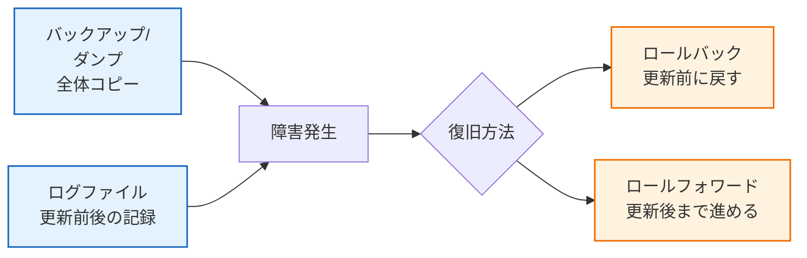
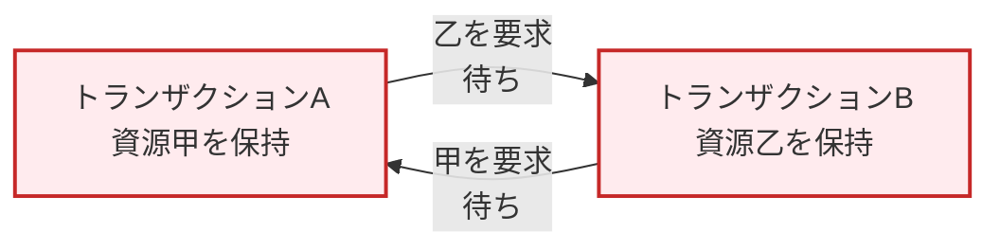

# 4.1 データベース｜トランザクションと障害回復

> 基本情報技術者 科目A PART 4 > 4.1 データベースの概要 對應｜最終更新 2026-10-03
> 回到 [[總覽]] ｜ 相關單詞：[[単語本#4. データベース|単語本 - データベース]]
> タグ：#FE/データベース #トランザクション #障害回復

---

## 1. 更新記録を保存するファイル（平成23年特 問33）

**中文**：把「更新前的值（Before Image）和更新後的值（After Image）」寫下來當作更新記錄的檔案，叫**ログファイル**。故障時靠它把資料庫恢復原狀。
**日文**：データベースの更新前や更新後の値を書き出し、更新記録として保存するファイルが**ログファイル**。障害時にこれを使って復旧する。

| 選項 | 中文 | 日文 | 判定 |
|---|---|---|---|
| ア ダンプファイル | 轉儲檔：某時間點的DB整體複本（快照） | ある時点のDB全体のコピー | × 整體複本，不是更新記錄 |
| イ チェックポイントファイル | 檢查點檔：記錄檢查點當下已完成的處理 | チェックポイント時点の処理完了情報を記録 | × 記錄完成狀態，不是更新前後值 |
| ウ バックアップファイル | 備份檔：DB複本，用於故障恢復 | 障害復旧用のDBのコピー | × 複本本身，不含更新記錄 |
| **エ ログファイル ★** | **日誌檔：更新前後的值，更新記錄** | **更新前・更新後の値を記録した更新記録** | **○ 正解** |

---

## 2. 障害回復の流れ

> **中文**：備份/轉儲是「底」，日誌是「帳」。故障時用底＋帳恢復：還沒完成的用更新前的值退回（ロールバック），已完成的用更新後的值重做（ロールフォワード）。
> **日文**：バックアップが「土台」、ログが「帳簿」。未完了は更新前でロールバック、完了済みは更新後でロールフォワードする。

---

## 3. 排他制御とデッドロック（平成23年秋 問34）

**中文**：多個交易同時碰同一份資料會打架，所以用「鎖」讓後來者等。**デッドロック**是等成一個圈：A抱著甲等乙、B抱著乙等甲，誰也動不了。
**日文**：複数トランザクションの同時アクセスで不整合が起きるため、ロックで待たせる。**デッドロック**は待ちの循環：互いに相手のロック資源を要求し、どちらも実行できなくなる状態。

| 選項 | 中文 | 判定 |
|---|---|---|
| ア 2相ロック（第1相上鎖→第2相解鎖） | 講的是上鎖規約本身 | × 不是デッドロック |
| イ 專有鎖互撞、一方等待 | 單純的鎖等待（blocking） | × 只有一邊等 |
| ウ 把使用中的資源鎖起來不給別人碰 | 鎖（排他制御）本身的定義 | × 不是デッドロック |
| **エ 互相要求對方鎖住的資源、都卡住 ★** | **等待成圈、無法執行** | **○ デッドロック** |

> **中文**：關鍵字是「互いに」「待ち状態となり実行できなくなる」。單邊等不算，互相等才算。
> **日文**：キーワードは「互いに」「実行できなくなる」。片方の待ちではなく、待ちの循環がデッドロック。

**補充：2相ロックとロックの種類**
- **2相ロック**：第1相（拡張相）只能上鎖、第2相（縮退相）只能解鎖，一次解鎖後不可再上鎖
- **共有ロック**：讀取用，彼此可共存（shared）
- **専有ロック**：寫入用，有它在別人什麼都不能做（exclusive）

### ロックの互換性（問30）

| 先に保持＼後から要求 | 共有ロック | 専有ロック |
|---|---|---|
| **共有ロック** | **○ 可能 ★ア** | × 待たされる |
| **専有ロック** | × 待たされる | × 待たされる |

> **中文**：只有「共有＋共有」能共存，其他組合都要等。看到「獲得可能」就選ア。
> **日文**：共存できるのは「共有＋共有」だけ。それ以外はすべて待ちになる。

---

## 4. 重要度まとめ

- 更新前後的值 = ログファイル（更新記錄）
- DB整體複本 = ダンプ/バックアップファイル
- 檢查點完成資訊 = チェックポイントファイル
- 恢復二招：ロールバック（退回）・ロールフォワード（重做）
- デッドロック = 互相等待成圈、誰也動不了（エ）
- 單邊等待（イ）・上鎖本身（ウ）・2相鎖規約（ア）都不是デッドロック

*出典：平成23年特 問33 / 平成23年秋 問34 / 問30*
