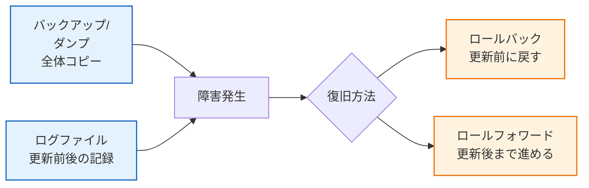

# 4.1 データベース｜障害回復

> 基本情報技術者 科目A PART 4 > 4.1 データベースの概要 對應｜最終更新 2026-10-03
> 回到 [[總覽]] ｜ 相關單詞：[[単語本#4. データベース|単語本 - データベース]]
> タグ：#FE/データベース #障害回復 #ログ

---

## 1. 更新記録を保存するファイル（平成23年特 問33）

**中文**：把「更新前的值（Before Image）和更新後的值（After Image）」寫下來當作更新記錄的檔案，叫**ログファイル**。故障時靠它把資料庫恢復原狀。
**日文**：データベースの更新前や更新後の値を書き出し、更新記録として保存するファイルが**ログファイル**。障害時にこれを使って復旧する。

| 選項 | 中文 | 日文 | 判定 |
|---|---|---|---|
| ア ダンプファイル | 轉儲檔：某時間點的DB整體複本（快照） | ある時点のDB全体のコピー | × 整體複本，不是更新記錄 |
| イ チェックポイントファイル | 檢查點檔：記錄檢查點當下已完成的處理 | チェックポイント時点の処理完了情報を記録 | × 記錄完成狀態，不是更新前後值 |
| ウ バックアップファイル | 備份檔：DB複本，用於故障恢復 | 障害復旧用のDBのコピー | × 複本本身，不含更新記錄 |
| **エ ログファイル ★** | **日誌檔：更新前後的值，更新記錄** | **更新前・更新後の値を記録した更新記録** | **○ 正解** |

---

## 2. 障害回復の流れ

> **中文**：備份/轉儲是「底」，日誌是「帳」。故障時用底＋帳恢復：還沒完成的用更新前的值退回（ロールバック），已完成的用更新後的值重做（ロールフォワード）。
> **日文**：バックアップが「土台」、ログが「帳簿」。未完了は更新前でロールバック、完了済みは更新後でロールフォワードする。

---

## 3. 重要度まとめ

- 更新前後的值 = ログファイル（更新記錄）
- DB整體複本 = ダンプ/バックアップファイル
- 檢查點完成資訊 = チェックポイントファイル
- 恢復二招：ロールバック（退回）・ロールフォワード（重做）

*出典：平成23年特 問33*
